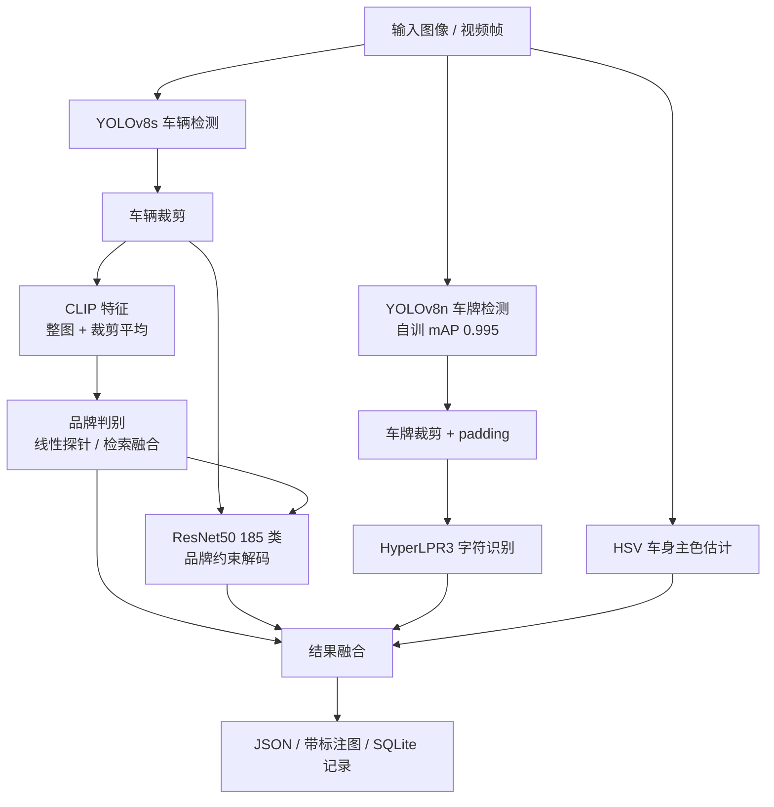

# 车辆识别系统 · 车牌 / 品牌 / 车型 / 视频

输入一张汽车图片或一段视频，输出**车牌号码、车牌类型、车辆品牌、车型、车身颜色**及各阶段置信度与耗时。

检测与分类模型为**本项目自训微调**（非调用现成 API），包含完整的训练 → 评测 → 服务化 → 前端演示链路，在 RTX 3050 Ti（4GB 显存）笔记本上完整跑通。

`Python 3.12` · `PyTorch` · `YOLOv8` · `ResNet50` · `CLIP` · `HyperLPR3` · `FastAPI` · `SQLite`

---

## 效果一览

以下均为本机实测结果，复现方式见 [评测与复现](#评测与复现)。

| 模块 | 模型 | 指标 | 数据 |
|---|---|---|---|
| 车辆检测 | YOLOv8s（COCO 预训练） | 单图 GPU 28 ms | — |
| 车牌检测 | **YOLOv8n 自训微调** | **mAP@0.5 = 0.9949**，P/R ≈ 99.9% | CCPD 8,846 / 987 |
| 车牌字符识别 | HyperLPR3 | 蓝牌 / 白牌警牌 / 新能源绿牌 实测 3/3 | 真实照片 |
| 车型分类 | **ResNet50 微调**（185 类） | **Top-1 90.10% / Top-5 98.31%** | Stanford Cars |
| 品牌（闭集） | CLIP 特征 + 线性探针 | 域内 83.7%，跨域街拍 42% | Stanford Cars |
| 品牌（开放词表） | CLIP 检索 + 文本零样本融合 | 街拍 **Top-1 56.2% / Top-3 70.8%**，中国品牌 45.5%（原 0%） | 自建 24 品牌 / 143 张 |
| 端到端 | 全流水线 | GPU **86.6 ms/张（11.5 FPS）**，CPU 409 ms，加速 4.7× | 真实照片 |

> 品牌「开放词表」指：新增品牌只需给几张参考图，**无需重新训练**，解决了闭集分类器完全无法识别中国品牌（比亚迪、理想、蔚来…）的问题。详见 [docs/brand_v2_eval.md](docs/brand_v2_eval.md)。

## 功能

- **图片识别**：上传/拖拽单张图片，返回结构化结果 + 带标注框的结果图
- **视频识别**：定时抽帧 → 逐帧识别 → 按车牌号跨帧聚合去重（保留最高置信度）+ 车型/品牌投票
- **识别记录**：结果自动入库（SQLite），支持来源筛选、缩略图预览、单条删除、清空
- **模块自动降级**：任一模型权重或依赖缺失时，其余模块仍可正常工作（例如没有分类权重时只输出车牌）
- **GPU/CPU 自适应**：有 CUDA 自动用 GPU，无则回落 CPU

## 系统架构



**品牌约束解码**：先用 CLIP 判品牌，再让 ResNet50 只在该品牌的车型类别内取 argmax；品牌不在车型词表时自动退回无约束解码。这样既保留细粒度分类能力，又避免了「品牌说 A、车型说 B 品牌」的自相矛盾。

## 快速开始

### 1. 环境

- Python 3.10+（实测 3.12.1）
- 可选：NVIDIA GPU + CUDA（CPU 也能跑，慢约 4.7×）
- Windows / Linux 均可，Windows 下注意路径不要包含 `|` 等非法字符

```bash
git clone https://github.com/<your-name>/vehicle-recognition.git
cd vehicle-recognition
python -m venv .venv
# Windows: .venv\Scripts\activate
source .venv/bin/activate
pip install -r requirements.txt
```

### 2. 准备权重

权重体积较大未入库，二选一：

**方式 A：下载 Release**

到仓库 `Releases` 页面下载并放到 `weights/`：

```
weights/
├── plate_detector.pt          # 自训车牌检测（YOLOv8n）
├── vehicle_classifier.pth     # 自训车型分类（ResNet50，185 类）
├── label_map.json             # 车型类别映射（与 .pth 必须配套）
└── clip_brand_probe.npz       # 品牌线性探针（可选）
```

`yolov8s.pt` / `yolov8n.pt` 无需手动准备，`ultralytics` 首次运行会自动下载。

CLIP 权重（品牌模块需要）：

```bash
# 国内网络建议加镜像：export HF_ENDPOINT=https://hf-mirror.com
huggingface-cli download openai/clip-vit-base-patch32 --local-dir models/clip-vit-base-patch32
```

**方式 B：自己训练**

见下方 [训练](#训练) 一节，训练脚本会自动产出上述权重。

### 3. 启动

```bash
uvicorn api.main:app --host 127.0.0.1 --port 8000
```

首次启动需加载 5 个模型，约 30–50 秒。看到 `Uvicorn running on http://127.0.0.1:8000` 即就绪。

> 不要加 `--reload`：热重载会反复重新加载全部模型，显存容易吃满。

- 演示页面：<http://127.0.0.1:8000>
- 接口文档（Swagger）：<http://127.0.0.1:8000/docs>
- 健康检查：`curl http://127.0.0.1:8000/api/health`

健康检查返回各模块是否可用：

```json
{"status":"ok","plate_detector":true,"ocr":true,"classifier":true,"brand_clf":true,"records_db":true}
```

### 4. 使用

**网页**：打开首页，三个标签页分别是图片识别、视频识别、识别记录。

**API**：

| 方法 | 路径 | 说明 |
|---|---|---|
| GET | `/api/health` | 各模块可用性 |
| POST | `/api/recognize` | 图片识别（multipart 上传，自动入库） |
| POST | `/api/recognize/annotated` | 图片识别并直接返回带标注的 JPEG |
| POST | `/api/recognize/video` | 视频识别（抽帧 + 聚合，自动入库） |
| GET | `/api/records` | 记录列表（`limit` / `offset` / `source_type`） |
| GET | `/api/records/{id}` | 单条详情 |
| DELETE | `/api/records/{id}` | 删除单条 |
| DELETE | `/api/records` | 清空全部 |
| GET | `/records/annotated/{file}` | 标注图静态资源 |

```bash
# 图片识别
curl -X POST "http://127.0.0.1:8000/api/recognize" -F "file=@test_images/bmw_black_plate.jpg"

# 视频识别
curl -X POST "http://127.0.0.1:8000/api/recognize/video" -F "file=@demo.mp4"

# 查询最近 20 条记录
curl "http://127.0.0.1:8000/api/records?limit=20"
```

返回示例（字段有省略）：

```json
{
  "plate": {"text": "京A12345", "type": "蓝牌", "confidence": 0.9985},
  "vehicle": {"brand": "BMW", "model": "3 Series Sedan", "color": "黑色", "confidence": 0.87},
  "timings_ms": {"detection": 133.0, "classify": 50.4, "ocr": 454.0}
}
```

## 训练

两条线都是**迁移学习 + 全参微调**，不是从零训练。

```bash
# 1) 车牌检测：CCPD -> YOLO 格式 -> 微调 YOLOv8n
python scripts/prepare_ccpd.py --src data/raw/ccpd_10k
python training/train_plate_detector.py --epochs 15 --bs 8

# 2) 车型分类：Stanford Cars（185 类）
python scripts/parquet_to_imagefolder.py --src data/raw/stanford --out data/stanford_cars
python training/train_classifier.py --data data/stanford_cars --epochs 15 --bs 8

# 3) 品牌线性探针（CLIP 特征 + 逻辑回归，无需训练主干）
python scripts/clip_brand.py --mode probe --export weights
```

关键训练配置：

| 项 | 车牌检测 | 车型分类 |
|---|---|---|
| 预训练 | yolov8n.pt（COCO） | ResNet50（ImageNet-1K V2） |
| 输入 | 640 | 256 → CenterCrop 224 |
| 优化器 | SGD（ultralytics 默认） | AdamW，骨干 0.1× / 分类头 1× 学习率 |
| 学习率 | 0.01 + 余弦退火 | 3e-4 + CosineAnnealing |
| 增强 | Mosaic（最后 10 epoch 关闭） | RandAugment + ColorJitter + 随机擦除 |
| 正则 | — | Label Smoothing 0.1 + weight decay 1e-4 |
| 硬件 | RTX 3050 Ti 4GB，bs=8，AMP | 同左，约 22 分钟 / 15 epoch |

## 评测与复现

```bash
# 跨域评估：自建 12 品牌实拍集，域内 vs 跨域对比
python scripts/eval_realworld.py

# 品牌开放词表：抓取 24 品牌街拍图，留出法评测
python scripts/fetch_brand_photos.py --per-brand 6
python scripts/brand_gallery.py --mode zs  --src test_images/brand_photos --holdout 2 --views face
python scripts/brand_gallery.py --mode loo --src test_images/brand_photos --holdout 2 --views face

# 推理性能基准（GPU / CPU）
python scripts/benchmark.py
```

评测报告见 `docs/`：

| 文档 | 内容 |
|---|---|
| [docs/DESIGN.md](docs/DESIGN.md) | 设计文档：方案选型、实施结果、踩坑记录 |
| [docs/eval_report.md](docs/eval_report.md) | 车型分类每类 P/R/F1 与最差类别 |
| [docs/realworld_eval.md](docs/realworld_eval.md) | 跨域实拍逐张预测与错误分析 |
| [docs/brand_v2_eval.md](docs/brand_v2_eval.md) | 品牌开放词表方案对比、视图消融、负结果 |

## 目录结构

```
vehicle-recognition/
├── api/
│   ├── main.py             # FastAPI 服务与接口
│   └── db.py               # SQLite 记录管理
├── inference/
│   ├── pipeline.py         # 核心流水线 VehicleRecognizer（模块级降级）
│   └── video.py            # 视频抽帧 + 跨帧聚合
├── training/
│   ├── train_plate_detector.py
│   └── train_classifier.py
├── scripts/                # 数据准备 / 评测 / 基准 / 导出
├── web/index.html          # 演示页（图片 / 视频 / 记录）
├── tests/                  # pytest
├── docs/                   # 设计与评估报告
├── weights/                # 模型权重（不入库）
└── requirements.txt
```

## 已知局限

1. **车型词表受限**：Stanford Cars 仅覆盖 1991–2012 年美规 185 款车型，中国特有车型（五菱宏光、比亚迪王朝系等）不在类别内，会给出最接近的错误答案
2. **品牌跨域仍有差距**：开放词表方案街拍 Top-1 56.2%，夜间/雨雪/强遮挡未验证；单品牌参考图仅 4 张，扩到 10–20 张可继续提升
3. **车牌 OCR**：HyperLPR3 对港澳黑牌、部分使馆牌支持较弱
4. **视频实时性**：当前是离线抽帧（2 FPS），未做流式/多目标跟踪，不适合实时长视频

## Roadmap

- [x] 推理流水线 + FastAPI + 演示页
- [x] 车牌检测微调（CCPD，mAP@0.5 0.9949）
- [x] 车型分类（185 类，Top-1 90.10%）
- [x] CLIP 品牌探针 + 品牌约束解码
- [x] 视频识别（抽帧 + 去重聚合）
- [x] 识别记录（SQLite + REST + 前端）
- [x] 品牌开放词表（检索 + 文本融合，中国品牌 0% → 45.5%）
- [ ] 换用 Car Models 3778（19.3 万张实拍）重训车型分类
- [ ] 车标检测作为品牌第三路证据
- [ ] 开放词表方案接入在线推理（低阈值输出 Top-3 候选）
- [ ] ONNX / TensorRT 导出与压测
- [ ] Docker 镜像验证与 CI

## Docker（实验性）

```bash
docker build -t vehicle-rec .
docker run -p 8000:8000 -v $(pwd)/weights:/app/weights vehicle-rec
```

镜像默认装 CPU 版 torch 以减小体积；GPU 部署需改基础镜像与 `--gpus all`。**该路径尚未在本机完整验证**，本地演示建议直接用 uvicorn 方式启动。

## 数据与致谢

- [CCPD](https://github.com/detectRecog/CCPD) — 中文车牌检测数据集
- [Stanford Cars](https://ai.stanford.edu/~jkrause/cars/car_dataset.html) — 车型细粒度分类数据集
- [HyperLPR3](https://github.com/szad670401/HyperLPR) — 中文车牌识别
- [Ultralytics YOLOv8](https://github.com/ultralytics/ultralytics) / [OpenAI CLIP](https://github.com/openai/CLIP)
- 评测图片来自 [Wikimedia Commons](https://commons.wikimedia.org/)，遵循各自许可
